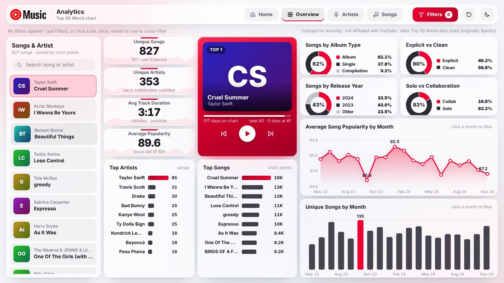
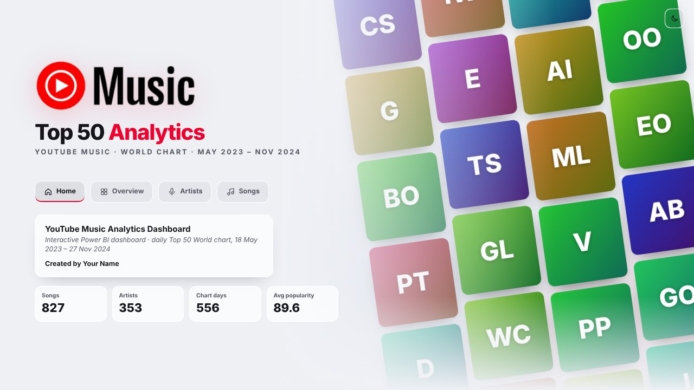
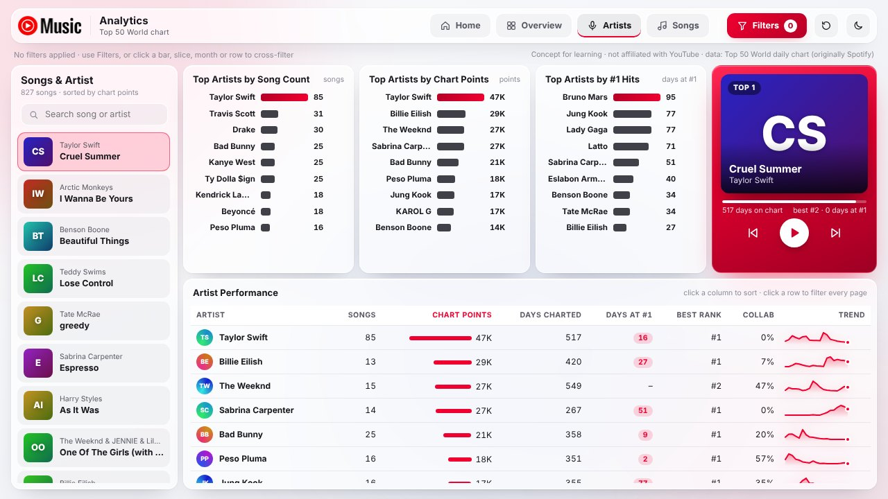
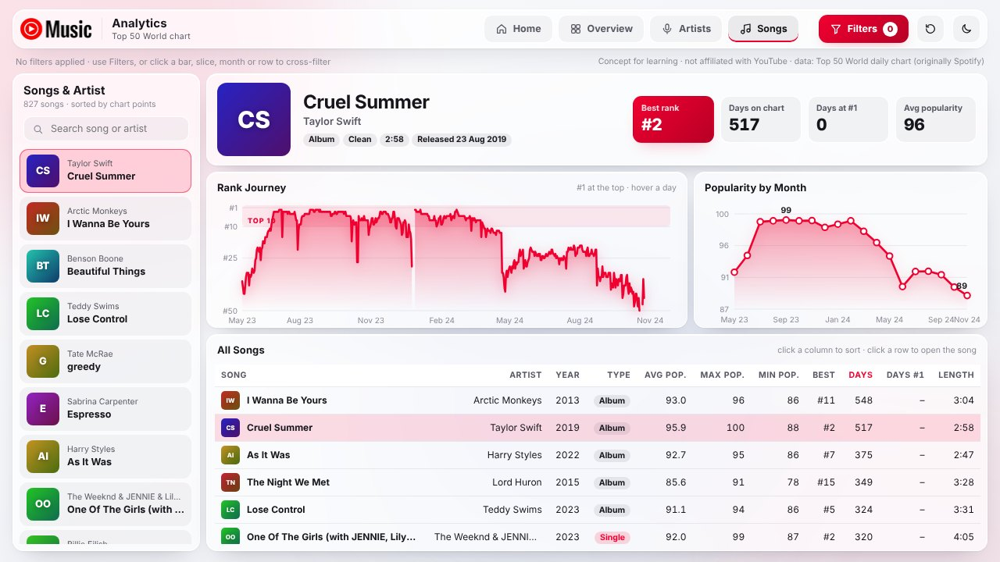
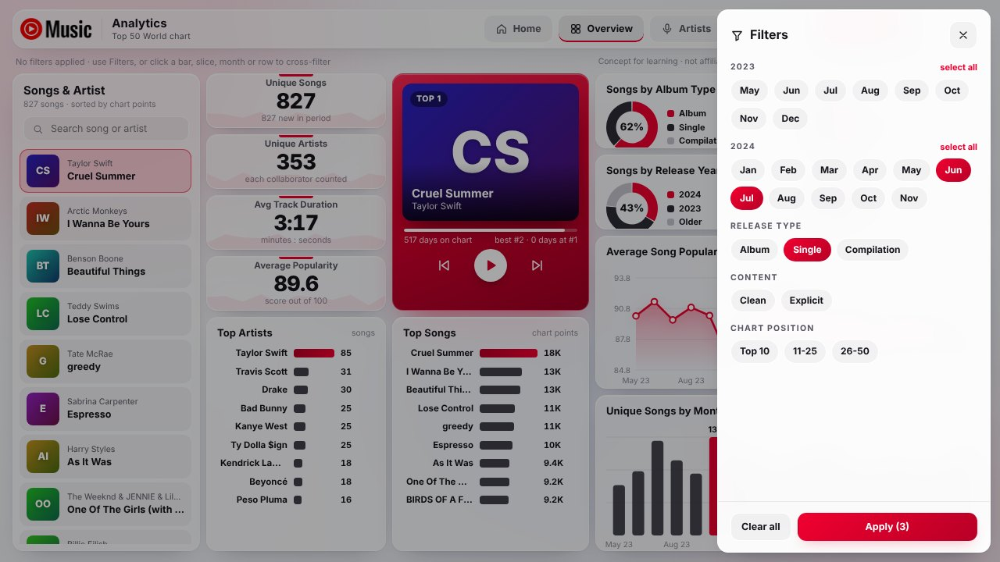
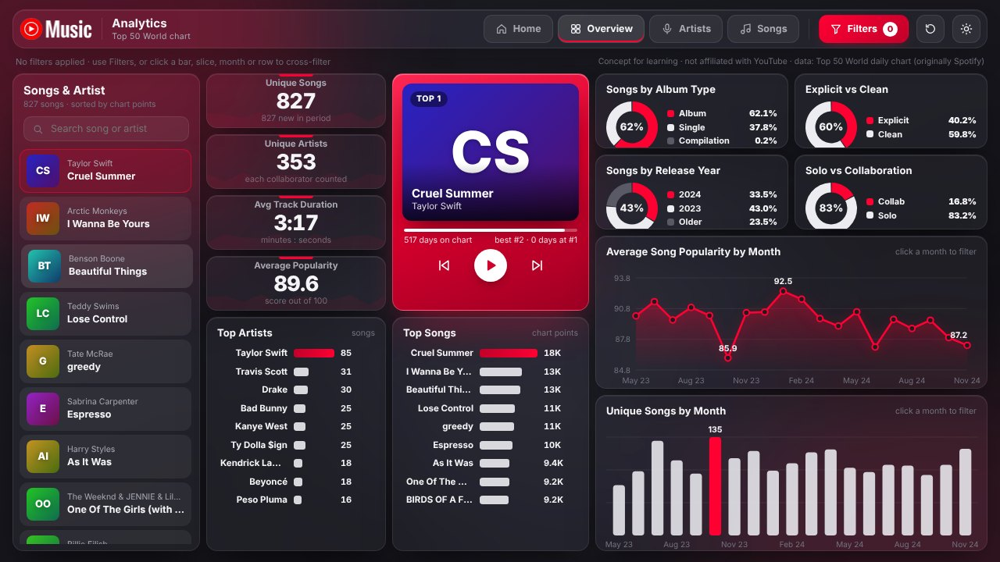

# 🎵 YouTube Music · Top 50 Analytics Dashboard
 
An interactive analytics dashboard of the **daily Top 50 World chart** (18 May 2023 – 27 Nov 2024):
**27,800 chart entries · 827 songs · 353 artists · 556 days**.
 

 
**Live demo:** https://sumitkryadav-automation.github.io/ytmusic-dashboard/ · no login needed, works in any browser
 

 
## Highlights
 
- **4 pages in one app:** Home · Overview · Artists · Songs
- **Now Playing card:** previous / next / auto-play through the song list
- **Slide-in filter panel:** months, release type, clean/explicit, chart position, applied only on *Apply*
- **Cross-filtering:** click a donut slice, a month, an artist bar or a table row to filter the whole page
- **Animated charts:** lines draw in, bars grow and numbers count up on every filter change
- **Glassmorphism UI** with light and dark mode (remembered per visitor)
- **Sortable tables**, tooltips on every element, search in the song list
- **Zero dependencies:** one self-contained `index.html` (HTML + CSS + vanilla JavaScript, hand-drawn SVG charts)
## Screenshots
 
| Home | Artists |
| --- | --- |
|  |  |
| **Songs** | **Filters** |
|  |  |
 
**Dark mode**
 

 
## Key insights from the data
 
- **40.2%** of chart entries are explicit; **62.1%** come from albums, 37.8% from singles.
- **40 songs** reached #1. *Die With A Smile* (Lady Gaga & Bruno Mars) held #1 for **77 days**.
- **Taylor Swift** leads on chart points and has the most charting songs (85).
- Average popularity stays between about **86 and 93** every month.
## Tech
 
| Part | How |
| --- | --- |
| Data prep | Python (pandas): cleaning, derived columns, compact encoding |
| Dashboard | HTML, CSS (glass effect, animations, themes), vanilla JavaScript |
| Charts | Hand-written SVG: line, column, donut, bar, sparkline, rank journey |
| Power BI edition | The same dashboard prepared as one DAX measure for the HTML Content visual (included as a design experiment) |
| Hosting | GitHub Pages |
 
## Run it locally
 
Download `index.html` and double-click it. No install, no server.
 
## Data & disclaimer
 
Concept project for learning and portfolio use, **not affiliated with YouTube or Google**.
The chart data is a public Top 50 World daily chart dataset originally published for Spotify, relabelled for this project.
The YouTube Music name and logo are trademarks of Google LLC.
 
---
Created by **Sumit Kumar Yadav** · [LinkedIn](https://www.linkedin.com/in/sumitkryadav-automation/)
 
